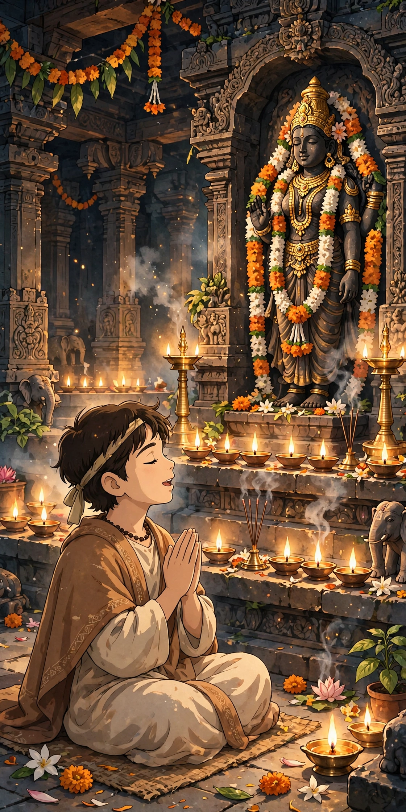
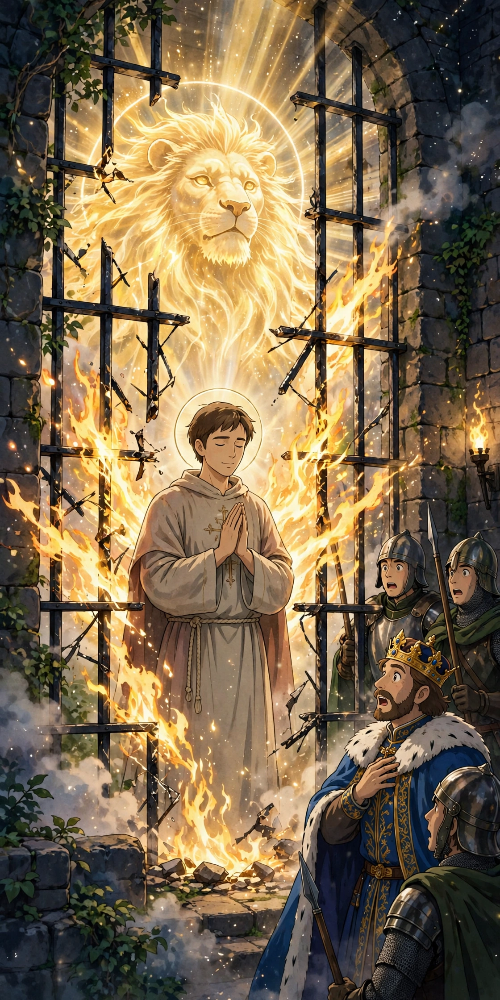

# Project for Annamayya

An anime-style motion video telling the story of **Annamayya** (Annamacharya),
the saint-poet of Tirumala, built with a fully automated pipeline:
Anime frames → ffmpeg frame-and-motion → Docker →
GitHub Actions → Kubernetes (EKS / AKS ready).

> Honest note: this is **frame-and-motion**, not true character
> animation. Anime still frames are animated with camera zoom and pan
> (ffmpeg `zoompan`) and cut together with narration.

## The story, stage by stage

### Stage 1 — Divine birth in Tallapaka
Lord Vishnu sends his sword Nandaka to be born as Annamacharya to the
childless couple Narayana Suri and Lakkamba in Tallapaka village, Kadapa
district. A divine light fills their humble home.


**Image prompt used:**
> Anime style illustration, vertical composition: a divine golden light
> descending from the sky over a small South Indian village at dawn, palm
> trees and humble tiled-roof houses, inside one home a newborn baby rests
> while parents pray with folded hands, warm glowing sacred atmosphere,
> Ghibli-inspired anime, soft colours, cinematic lighting, no text

### Stage 2 — Pilgrimage up the seven hills
Drawn by the beauty of Lord Venkateswara, young Annamayya walks barefoot
up the seven holy hills (Saptagiri) to Tirumala, helped on the way by
Goddess Lakshmi herself in the form of an old lady.


**Image prompt used:**
> Anime style illustration, vertical composition: a young man in a simple
> white dhoti walking barefoot up a forested mountain path of seven green
> hills toward a distant golden temple tower glowing at sunrise, morning
> mist, birds, devotional mood, Ghibli-inspired anime, soft colours,
> cinematic wide view, no text

### Stage 3 — Singing before the Lord
Reaching Tirumala, Annamayya settles there and pours his love into
thousands of hymns (sankeertanas) sung only for the Lord, never for any
human being.



**Image prompt used:**
> Anime style illustration, vertical composition: a young saint with
> folded hands singing in devotion before a majestic dark stone temple
> deity adorned with gold ornaments and flower garlands inside a grand
> South Indian temple sanctum, rows of glowing oil lamps, incense light,
> reverent sacred mood, Ghibli-inspired anime, rich warm colours, no text

### Stage 4 — The prison miracle
When King Saluva Narasimha demands a song in his own praise and Annamayya
refuses, he is jailed. He calls upon Narasimha, the lion form of the Lord,
and the iron bars burst into flames, freeing him.



**Image prompt used:**
> Anime style illustration, vertical composition: a calm saint standing
> with folded hands inside a prison cell as the iron bars burst into
> divine golden flames, a majestic glowing lion-headed divine form
> appearing in light behind him, an astonished king and guards watching
> from outside, dramatic sacred light, Ghibli-inspired anime, no text

### Legacy (narration close, no separate frame)
His works, saved by the Lord's grace from fire, were converted from palm
leaves to copper inscriptions by the king and Annamayya's son, preserving
them for eternity. His songs still echo in Tirumala today.

## Videos in this repo

- `video/project-for-annamayya-en.mp4` — 43.5 s, 1080×1920, English narration
- `video/project-for-annamayya-te.mp4` — 46.2 s, 1080×1920, Telugu narration
- Narration scripts: `audio/narration-en.txt`, `audio/narration-te.txt`
- Narration audio: `audio/narration-en.mp3`, `audio/narration-te.mp3`

## Build the video locally

Requirements: `ffmpeg` only.

```bash
# English version
./scripts/build.sh audio/narration-en.mp3 video/project-for-annamayya-en.mp4

# Telugu version
./scripts/build.sh audio/narration-te.mp3 video/project-for-annamayya-te.mp4
```

The script splits the narration evenly across the 4 stage frames, renders
each frame with a camera move (zoom in, pan right, zoom in, zoom out),
cuts the segments together with hard cuts (no blending), and muxes the
narration in. Output is 1080×1920, 30 fps, H.264 + AAC.

## Run it with Docker

```bash
docker build -t project-for-annamayya .
docker run -d -p 8080:80 project-for-annamayya
# Open http://localhost:8080
```

The image serves `index.html` with both video versions via nginx.

## CI/CD — GitHub Actions

`.github/workflows/build-video.yml` runs on every push to `main`:

1. Checks out the repo.
2. Installs ffmpeg.
3. Rebuilds both video versions with `scripts/build.sh`.
4. Uploads the two mp4 files as workflow artifacts.
5. Builds the Docker image (no push — pushing needs Docker Hub secrets
   that are intentionally not stored here).

## Kubernetes

`k8s/deployment.yaml` + `k8s/service.yaml` run the nginx image with
2 replicas behind a Service:

```bash
kubectl apply -f k8s/
kubectl get pods,svc -l app=project-for-annamayya
```

For a free local demo, use [kind](https://kind.sigs.k8s.io/)
(Kubernetes in Docker) — no cloud account needed:

```bash
kind create cluster --name annamayya
kind load docker-image project-for-annamayya:latest --name annamayya
kubectl apply -f k8s/
kubectl port-forward svc/project-for-annamayya 8080:80
```

## Cloud deploys — EKS (AWS) and AKS (Azure)

See `deploy/eks-notes.md` and `deploy/aks-notes.md` for the exact steps.

> ⚠️ **Cost warning — read before you deploy to a real cloud.**
> A real Amazon EKS cluster costs about **$70+ per month for the control
> plane alone**, plus worker-node charges, and it is **not** AWS Free Tier
> eligible. AKS's control plane is free, but its worker nodes are paid.
> Nothing in this repo creates a cluster by itself. The cloud steps are
> documents and manifests only — creating a cluster is a deliberate,
> paid decision you make yourself, after checking current pricing.

## Project layout

```
project-for-annamayya/
├── README.md                  # this file — story, prompts, pipeline
├── index.html                 # video web page served by nginx
├── Dockerfile                 # nginx image serving the page + videos
├── images/                    # 4 anime stage frames + cover
│   ├── stage1-divine-birth.webp
│   ├── stage2-pilgrimage-hills.webp
│   ├── stage3-temple-singing.webp
│   ├── stage4-jail-miracle.webp
│   └── cover.jpg
├── audio/                     # narration scripts + mp3 audio
├── video/                     # built mp4 videos (EN + TE)
├── scripts/
│   └── build.sh               # ffmpeg frame-and-motion builder
├── .github/workflows/
│   └── build-video.yml        # CI: rebuild videos + docker build
├── k8s/
│   ├── deployment.yaml
│   └── service.yaml
└── deploy/
    ├── eks-notes.md           # AWS EKS steps (docs only, paid)
    └── aks-notes.md           # Azure AKS steps (docs only, paid)
```

## Credits

- Story: the life of Annamacharya, as told in the 1997 film *Annamayya*
  (directed by K. Raghavendra Rao, music by M. M. Keeravani).
- Visuals: original anime frames generated for this project.
- Narration: original scripts written for this project, synthetic voice.
- This is a devotional fan/educational work, not affiliated with the film
  or the temple.
